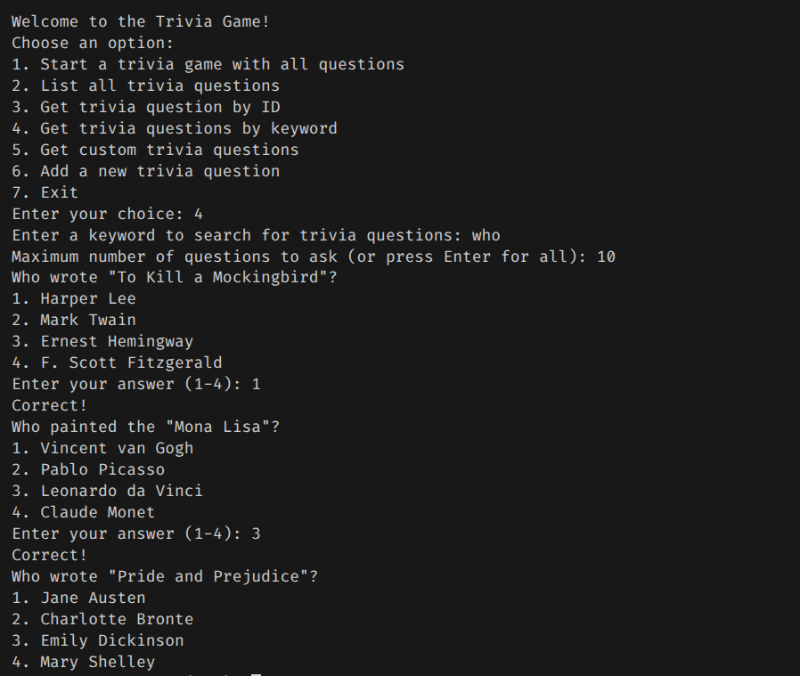
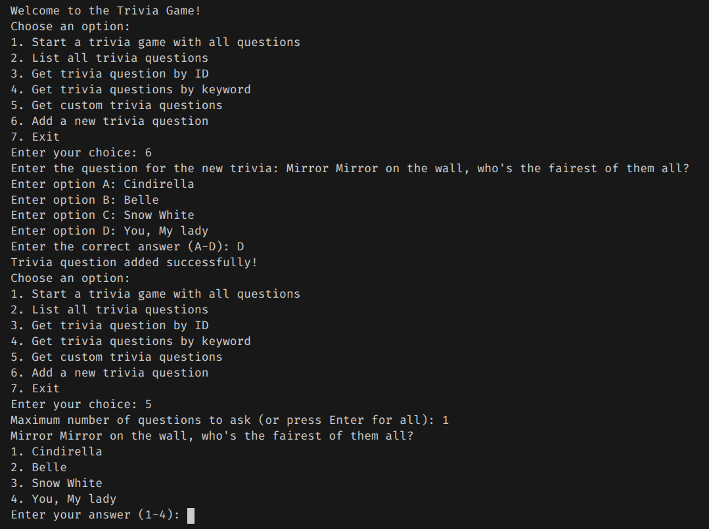

## Project Description

This is a simple Trivia question program that comes bundled with 50 questions but also allows the user to add their own. It provided an API to run through all the questions (or limit them with a filter), search trivia questions by keyword, go through custom trivia questions, or navigate to a specific one. This would, in practice, help students prepare for an exam by allowing them to quiz themselves.

## Example Test Runs

```
Welcome to the Trivia Game!
Choose an option:
1. Start a trivia game with all questions
2. List all trivia questions
3. Get trivia question by ID
4. Get trivia questions by keyword
5. Get custom trivia questions
6. Add a new trivia question
7. Exit
Enter your choice: 1
Maximum number of questions to ask (or press Enter for all): 10
What is the boiling point of water at sea level?
1. 100°C
2. 90°C
3. 80°C
4. 70°C
Enter your answer (1-4): 1
Correct!
What is the largest continent on Earth?
1. Africa
2. Asia
3. Europe
4. North America
Enter your answer (1-4): 2
Correct!
What is the chemical symbol for carbon?
1. C
2. O
3. H
4. N
Enter your answer (1-4): 1
Correct!
Who wrote "Pride and Prejudice"?
1. Jane Austen
2. Charlotte Bronte
3. Emily Dickinson
4. Mary Shelley
Enter your answer (1-4): 4
Incorrect! The correct answer is: Jane Austen
What is the chemical formula for water?
1. H2O
2. CO2
3. NaCl
4. O2
Enter your answer (1-4): 1
Correct!
Who wrote "The Divine Comedy"?
1. Dante Alighieri
2. Geoffrey Chaucer
3. John Milton
4. William Blake
Enter your answer (1-4): 3
Incorrect! The correct answer is: Dante Alighieri
What is the largest island in the world?
1. Greenland
2. Australia
3. New Guinea
4. Borneo
Enter your answer (1-4): 2
Incorrect! The correct answer is: Greenland
What is the largest glacier in the world?
1. Lambert Glacier
2. Perito Moreno Glacier
3. Vatnajökull Glacier
4. Hubbard Glacier
Enter your answer (1-4): 3
Incorrect! The correct answer is: Lambert Glacier
Who painted "Starry Night"?
1. Vincent van Gogh
2. Pablo Picasso
3. Leonardo da Vinci
4. Claude Monet
Enter your answer (1-4): 1
Correct!
What is the chemical formula for carbon dioxide?
1. CO2
2. H2O
3. NaCl
4. O2
Enter your answer (1-4): 1
Correct!
Game over! Your score is: 6 out of 10
Choose an option:
1. Start a trivia game with all questions
2. List all trivia questions
3. Get trivia question by ID
4. Get trivia questions by keyword
5. Get custom trivia questions
6. Add a new trivia question
7. Exit
```






## AI usage
I used a substantial amount of AI for this project. I used Google's gemini to look up questions about how to do things in sql because it was unfamiliar. When I tried to write straight sql code in its own file, I looked up how to execute that in Java but I found the approach a bit intimidating. I used co-pilot to generate and clean the trivia data that I ended up putting in the `trivia.csv`. I also used it to generate a lot of the code I used. I tried to make it use the `CreateDB.java` template but it was just way off so I frequently found myself needing to start a couple of phrases before it figures out what I want to write. I found it rather convenient that I didn't need to constantly look up methods and techniques to complete relatively basic tasks for this projects' needs. I used it to help me figure out the SQL querries that would search, filter, randomize, and count accordingly. I also used it to generate the javadoc. But in all of this, I was responsible for starting the first couple characters and I saw that the auto-complete knew what I wanted to write so I just used it instead of typing it manually.
